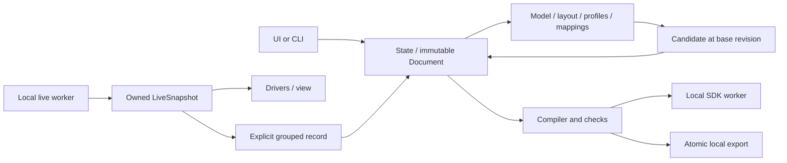

<!--
SPDX-FileCopyrightText: Copyright (c) 2026 NVIDIA CORPORATION & AFFILIATES. All rights reserved.
SPDX-License-Identifier: Apache-2.0
-->

# Implementation and verification notes

This document records the data boundaries and reproducible reference inputs for
the [Tactile Metadata Editor](README.md). The functional specification remains
[DESIGN.md](DESIGN.md). A described implementation path is not a claim that its
browser, NumPy, model or official SDK runtime was exercised; see the
[verification record](#verification-record).

## Ownership and module flow



| Module | Responsibility |
| --- | --- |
| `domain` | Frozen JSON-compatible records, UUID entities and independent draft/live snapshots |
| `document` | Numeric JSON, exclusive `editor.draft`, relative paths and atomic file saves |
| `state` | Single edit owner, candidates, monotonic revision, content hashes and bounded undo/redo |
| `model` | yourdfpy graph/FK, visual-instance meshes, resource hashes and link adjustments |
| `layout` | Transient range specification, permitted surface projection and selection |
| `profiles.hand` | HandJoint names, wrist root and derived segment mounts |
| `mappings.lbs` | Original four-slot edits, validation and point LBS |
| `compiler` / `checks` | Shared row order, target dtype, local issues and independent SDK result |
| `sdk` / `sdk_worker` | Short local SDK probe/construction/encoding process |
| `export` / `cli` | Snapshot-consistent packages and command status |
| `live` / `live_worker` | Authenticated local receiving, latest owned snapshot and process lifecycle |
| `drivers` | Named JointState/HandPose and explicit source correspondence |
| `ui` / `ui_bridge.js` | Form/view presentation and queued browser gestures |

Document is the editable authority. Frozen nested maps/tuples own their values;
mutable SDK views are never retained. A Candidate includes its `base_revision`;
State rejects stale candidates while accepting semantic errors as draft edits.
Undo/redo restore data and still advance revision. Dirty checks hash canonical
persistent content, including shared model configuration for each affected side.
View state, live frames, mesh caches and preview angles are outside that hash and
history. Saving one side does not clear another side's changes.

Segment definitions and B rows remain independent, as do taxel P records and
the two raw skinning arrays. Invalid lengths are not zipped, truncated, repaired
or replaced with fake identity poses. Explicit segment reorder remaps legitimate
references, including zero-weight slots, while preserving missing/invalid values.
Necessary missing rows in an explicit reorder use `null`; importing or recording
does not add them. Deleted segment references retain a dangling UUID marker.
Only provenance from an explicit tool deletion permits later removal/reuse of
that deleted taxel row; an imported orphan row is not identified by its shape or
a coincidentally named dictionary key.

## Frames and raw numerical authority

Positions are meters and angles radians. Stored poses are XYZ followed by XYZW.
`T_A_B` maps coordinates from B to A. M is the URDF root, W the configured wrist
root, J a segment and X a taxel. GUI millimeters/degrees and Viser WXYZ convert
only at their interfaces.

Let `G(q) = T_M_W` and let `FK_link(q)` be yourdfpy's link pose. The authoritative
binding arrays are `Device.segment_bind_poses` (B) and `Taxel.bind_pose` (P).
For a linked segment, the derived link-local mount is:

```text
A_j = inverse(FK_link(q0)) * G(q0) * B_j
```

Changing q0, wrist calibration, link association or a link adjustment recomputes
A from the same raw B. It does not round-trip B/P through matrices. A missing
wrist/mount may make a preview unavailable, while the invalid draft remains
editable. Plain numeric metadata without a URDF does not require visualization
attachments for numerical export.

`model` uses yourdfpy for FK, including fixed-edge refresh after origin changes.
Adjustments rebuild from original joint origins rather than accumulating each
frame. Supported mimic chains reduce to an actuated source or produce a capability
error. Visual origin, instance transform and mesh scale are baked once into
link-local meshes. Geometry identity retains link/visual/instance distinctions;
normals are recomputed after scale, and reflection winding is not flipped twice.
One task hashes model resources before checking individual cached attachments.
A content change invalidates the corresponding attachment.

Range generation happens in W at q0. Allowed links and the seed's connected
surface components bound the query. Rays span twice the configured depth; normal
filtering uses 75 degrees and the legal hit nearest the seed is selected. A
shared-edge duplicate at the same surface is not a second ambiguous surface.
Failure does not fall back to a nearest point. Directions use rotation only.
Excluded cells create no taxel; failed included cells keep a missing pose and
their output index. BatchSpec is transient and is not persisted as a region or
batch entity.

LBS reads every original slot:

```text
p_current = sum_k weight[k] * C[index[k]] * inverse(B[index[k]]) * p_bind
```

Repeated slot indices are legal. A single unique positive-weight segment permits
a rigid orientation; several distinct positive-weight segments define position
without a unique rigid orientation. Missing required live joints make affected
points unavailable. HandPose supplies `C_j = inverse(H_WRIST) * H_joint`;
JointState drives only URDF. No source fallback or HandPose-to-URDF twist inference
is used.

Live layers retain taxel UUIDs, named Hand joints and explicit validity separately
from coordinates. Missing geometry can reuse finite historical positions only
within the same epoch, 3D metadata source and fingerprint. Latest received
validity gates each taxel's positive-weight Hand dependencies, skeleton edge and
owned force arrow before asynchronous rebuilding completes. JointState display
reuses the named-mapping validator without FK for this immediate availability
check. Paused layers retain their own validity; force tables label the layer's
sequence, local read and document revision.

## Compilation, JSON and fingerprints

`compile_device(snapshot, device_id, model=None)` returns a derived CompiledDevice
or a CompileFailure with located issues. Output indices must cover 0..N-1
exactly. Formal tool export requires N>0; the schema's empty vectors remain
permitted by `canonical_values` and `metadata_fingerprint`.

Before casting, indices must be finite non-boolean integers in uint32 range and
reference an existing segment, including zero-weight slots. Integer-valued floats
such as 2.0 are accepted without changing the draft. Large Python integers are
checked before float conversion. Poses have width seven; influence rows have
width four. Computation uses float64 and final arrays are owning C-contiguous
float32 poses/weights and uint32 indices. Internal arrays are read-only; public
array properties return independent read-only copies, rather than exposing an
owning base through a view.

The [shared native validator](../../src/core/schema/cpp/inc/schema/tactile_metadata_validation.hpp)
defines the numerical checks. Weight sums accumulate converted float32 values in
double precision and allow absolute error <=1e-5. Quaternion products, left-to-right
additions, subtraction of one, and the 1e-4 threshold follow float32 arithmetic.
The geometry pose boundary reuses this target-dtype rule. For example, raw
`q=(0,0,0,1.00005)` exceeds the raw float64 threshold but its converted norm error
is approximately `9.989738e-5` and is allowed. Raw weights
`(.50000499,.50000499,0,0)` pass a raw sum comparison but their target values
exceed the sum tolerance and are rejected. Final official status still comes from
SDK construction.

Canonical values use the target dtype, joint names, original slot order, fixed
key order, compact finite JSON and SHA256, excluding `editor`. A fingerprint is
not the hash of a pretty-printed JSON file. Fingerprint declarations require 64
hexadecimal characters; comparisons use lowercase without rewriting saved text.
An offline structurally valid declaration does not prove that its live baseline
or physical device matches.

Persistence uses the raw Document values. `metadata_payload(..., values=...)`
uses compiled values only as evidence that complete output is available; its
numeric arrays still come from the snapshot. Pure `.values.json` likewise uses
`raw_values(..., output_order=True)`. Dtype-rounded request values never replace
saved decimals or weights. Nonfinite JSON is rejected, including exponent
overflow such as `1e999`; in-memory invalid values remain editable/checkable.

## Local workers and browser transactions

SDK imports occur in workers launched with the parent's `sys.executable`, argument
arrays, inherited environment and inherited module search configuration. No shell,
alternate interpreter, fixed SDK path or extra SDK installation is involved.
`ISAACCAPTURE_LOGGING=off` prevents native SDK logging from becoming a parent
protocol. Diagnostics are bounded separately from result data.

The short SDK worker receives versioned file requests for probe/encode and has a
30-second timeout. It uses public HandSkeletonRef/LBS/TactileMetadata constructors,
copies returned arrays, calls `to_bytes()`, and uses the SDK's
`TRACKER_METADATA_MAX_SIZE`. The parent checks exit/report agreement and actual
binary length before releasing temporary files. Probe success establishes
availability only. Reports contain finite JSON summaries; CompiledDevice arrays
and encoded bytes are not serialized through dataclass conversion.

The live parent listens on a loopback ephemeral port. A private request file
contains version/token/configuration. Frames use a four-byte network-order length
and finite UTF-8 JSON with an 8 MiB limit. Version/token/epoch checks authenticate
the local worker. SDK arrays and validity flags are copied before the next update.
Only the latest complete snapshot is retained. Sending is capped at 30 Hz; a
one-second absence of messages marks interruption. These limits do not measure
producer freshness or hardware synchronization. Stop is followed by bounded
waiting, termination and process/thread cleanup.

The Viser 1.1.1 browser bridge reports ordered begin/update/end/cancel gestures,
number confirmation and undo/redo to a loopback HTTP endpoint. Origin, token,
editing client and gesture identity are checked. Callbacks enqueue events; the
state owner applies transactions. Drag updates preview a Candidate and end commits
once, including release outside the control. Cancel commits nothing, duplicate
events do not duplicate edits, and Enter/blur do not double-commit a number. A
confirmed number changes one field; slider intent uses proportional editing.
Undo cancels unfinished input first. No debounce interval decides when a drag ends.
UI startup must check that existing Viser client assets can be used without
invoking its implicit Node/npm/client builder. Fixed-version DOM assumptions and
the real browser interactions still require browser verification.

## Atomic package publication

`export_package(snapshot, device_ids, ExportOptions(out, format), model=None)`
checks selected sides against one immutable revision. SDK packages retain and
reuse that check's exact encoded bytes. Sides and nonempty collections are unique;
explicit source-map/input-reference conflicts are errors. No correspondence
means a blank CSV source column, not the output index.

The target must be new or empty. `lstat` rejects symlinks before path resolution.
All outputs are written to one private sibling directory; actual file bytes are
hashed and counted. Only after all sides/files succeed does `os.replace` publish
the directory. An empty target is not removed first. Failure leaves no partial
published package. JSON/CSV files preserve raw numbers; SDK bytes use target
dtypes. The manifest lists artifact hashes/sizes and the report lists explicit
statuses/issues/encoded lengths. Neither contains NumPy arrays or encoded bytes.

## Manual model references

[left.manual.metadata.json](examples/left.manual.metadata.json) and
[right.manual.metadata.json](examples/right.manual.metadata.json) are independent
single-hand references. UUIDv5 identifiers are stable per side/entity. q0 is zero
for all named joints, within the limits recorded in these assets. The wrist frame
is explicitly each URDF root frame with identity mount: left `base_link`, right
`hand_base_link`. This defines a reference coordinate frame, not anatomical
calibration. The chosen O/F/D are `(0,0,0)`, `(0,0,1)`, `(0,1,0)` in that link.

The INDEX_DISTAL chain is `index_mcp_roll`, `index_mcp_pitch`, `index_pip`,
`index_dip`. Its origin rotations are zero in both checked files. A temporary
standard-library XML calculation summed these existing origin translations at
zero q; no runtime FK engine was added:

| Side | B_INDEX_DISTAL translation in W (meters) | STL triangle indices |
| --- | --- | --- |
| left | `(-0.019136805704482132,-0.031156338118399258,0.12279624331783398)` | 0,1 |
| right | `(-0.01913680360001739,0.02885,0.12279588249293394)` | 0,1,2 |

For each listed binary STL triangle in `meshes/index_distal.STL`, the taxel point
is the mean of its three vertices. The selected visual origin is identity and
its scale is one. +X is the normalized first edge, +Z the normalized winding
cross-product, and +Y=Z cross X. That proper rotation was converted to XYZW; the
point was translated by B_INDEX_DISTAL into W. For triangle zero, the mesh-local
centroid is `(-0.009390190243721008,-0.0002515779051464051,-0.011702263106902441)`
in each checked mesh. Full computed precision is retained in JSON.

Every reference taxel uses `[1,1,1,1]` and `[0.25,0.25,0.25,0.25]`. There are no
surface attachments, generated geometry keys or input-source references;
provenance is `manual`. The XML/STL calculation did not call Model, yourdfpy,
trimesh or a projection routine and makes no physical calibration claim. Full
model resource hashes are stored under `editor.model.asset_hashes`.

| Source | SHA256 |
| --- | --- |
| Left top-level URDF | `0417c9d34542d098d32f123211f3048b51fc51d3c66f4ec71dd23acbcb209b5d` |
| Right top-level URDF | `d3d919db4059288ecfe5f6c1a5546b536a0042723975e43b07318507d56109cf` |
| Left index_distal.STL | `719d02f83aa1b69693f1b478ca9de4afb804a02630cd6920977c3f75b9a45a99` |
| Right index_distal.STL | `b806badc8765acb6ed9401a0fb23d90e7ae6ff2f3a77ff40b014e063140b8e06` |

Reference outputs are generated from raw Document rows and CSV UUIDs with blank
input columns. They are expected comparison files, without a passed export
report/manifest or binary. In a supported environment, run the README's actual
check/export commands, then compare a JSON package's values/CSV to these
references. Complete metadata paths depend on the final export location and
therefore are not expected to be byte-identical to the reference metadata file.

| Reference file | File SHA256 |
| --- | --- |
| `left.manual.metadata.json` | `7f13c049e368df231a7007af7f1cfe751fdef1f655e91b8ec60fb26684c6404e` |
| `left.reference.values.json` | `5f5cb7ca92e2402cd159ab35f51c761e9a77662302c96c7946578171ce6b57e9` |
| `left.reference.taxels.csv` | `6d8d02fa1d3f159fbe1df6107455f89204116b472fa0f2bcd38f17918f61e416` |
| `right.manual.metadata.json` | `79d2e5822e31bac1a6a816794fac78b13d52a6502087d1dc79fb8023a650ca8d` |
| `right.reference.values.json` | `86fbed912c67840588d94e9e67a08898b15be2960f5ef85e838e3270713a591f` |
| `right.reference.taxels.csv` | `d2b8a32037f4cc4381f9f7e9c5b0b550b9926f88eb556d963a5b15c862bf4e01` |

The canonical metadata fingerprints, distinct from the file hashes above, are
`2ee5e27437b502f312fc16a04318801db9700bc1a8feae7b6af834b78e87a4d1`
(left) and
`8ba87e4c81476092dad14e562e3cc4e6f0481f8bd4b31c60accf2426fa0143e0`
(right). This records numeric helper output, not a live-source match.

## Verification record

Recorded on 2026-10-26 using
`/Applications/Xcode.app/Contents/Developer/usr/bin/python3`, Python 3.9.6. This
is below the supported runtime range. NumPy, Viser, yourdfpy, trimesh, rtree and
Isaac Capture SDK were absent. Scoped checks used `python3 -B` from this tool
directory and temporary files under `/tmp`; no dependency/environment/SDK was
installed or built and no other interpreter was selected.

| Area | Observed result and limit |
| --- | --- |
| Draft ownership/state | Standard-library checks covered nested immutability, independent malformed row counts, UUIDs, stale candidates, dirty hashes, grouped backup failure and undo/redo. |
| Raw persistence | Both manual references saved/reopened with original B/P numbers, duplicate slots, IDs and the same resolved model paths; temporary Save As files were under `/tmp`. |
| Canonical numerical helpers | Target float32 threshold cases, finite/range checks, raw four slots, canonical fingerprints and schema-empty vectors exercised without NumPy. This is not NumPy array or SDK execution. |
| Source declarations | SHA256 shape/case comparison, complete context conflicts, invalid indices and blank CSV source fields checked offline. No live/physical correspondence inferred. |
| Export failures/publication | Missing NumPy caused real application export failure without targets/partial staging. Independent filesystem helpers exercised new/empty atomic replacement, symlink/nonempty refusal and actual hash/byte counting. A successful application package was not produced. |
| CLI | Help/argument/unsupported-version exits checked; headless check helper produced a finite failed report without importing SDK/Viser. Supported-runtime success and SDK-unavailable exit 3 were not reached end to end. |
| Synthetic IPC/lifecycle | Real standard-library demo workers exercised built-in metadata, 16 force rows, 26 HandPose entries, distinct two-side collections, named joints and synthetic markers. Heartbeat interruption/recovery, normal stop and abnormal exit invalidated current samples and cleaned up workers, threads and temporary files. The parent did not import NumPy/SDK. This does not verify NumPy drivers, model rendering or SDK reception. |
| Local browser-event protocol | Actual standard-library loopback HTTP checks covered CORS, ordered acknowledgements, duplicate-request admission, invalid Origin and sequence gaps. Concurrent identical retries were admitted once. These checks did not launch Viser or a browser and do not validate DOM or pointer behavior. |
| UI state/event helpers | Actual State and editor event helpers exercised candidate-only updates, one commit per end, cancellation, raw number edits, active-input ownership, generation-tagged acknowledgements and a new document at revision zero. Rendering callbacks were omitted; these are state/event checks, not simulated Viser or browser success. |
| Live display helpers | Standard-library checks exercised stable-identity history, per-joint/taxel validity and arrow ownership, JointState availability without FK, and pausing while a newer invalid sample awaited rebuilding. Fixtures supplied protocol values and model descriptions; no NumPy/LBS/FK, Viser renderer or browser was executed. |
| Actual model/library/browser | Not run: yourdfpy/trimesh model loading, NumPy drivers/compilation, Viser controls, bridge DOM/pointer behavior, selection and browser rendering. Node and Ruff were not on PATH; JS parsing and Ruff formatting were not run. |
| Official SDK/runtime/hardware | No official success evidence: construction/readback/encoding, real receiving and physical calibration remain unverified. |
| Performance | No application generation/selection/motion timings, CPU or memory measurements were taken. The 30 Hz cap is configuration, not achieved throughput. |

Implementation supervision compared existing file hashes and Git status against
the initial local baseline. Writes remained in this subtree and the shared UI
dependency declarations; the original directions and model assets were preserved.
No environment was installed or built, and no remote execution or repository-wide
checks were performed. One reviewer used an overbroad read-only `/tmp` search and
encountered old cache filenames. That search was stopped; the cached code and
environment were not imported, executed or used. Subsequent review searches were
restricted to explicit task files and the identified SDK/source references.

A read-only XML/binary-STL inventory found 22 links, 21 joints and 22 visual mesh
instances in each top-level single-hand model. The left assets total 194377
triangles; right total 169260. The package-URI variant's 22 resources were
unresolved without an explicit package map. These are asset counts, not a model
load, render or performance benchmark. The assets do not exercise mimic chains,
nonuniform scale or a genuine two-hand model.

The remaining verification sequence is: use an existing supported Isaac Capture
environment, load a bundled single-hand reference, inspect q0/segments, generate
a range, select/edit raw slots, save/reopen, play/pause/edit/undo/resume the marked
demo, inspect local issues, and export/compare actual values/CSV. Browser gestures
must include release outside controls, cancellation, duplicate events and
Enter/blur. With an already available SDK/runtime/device, additionally exercise
official encode and real receiving failures/success, named JointState validity,
metadata changes and cleanup. A two-hand verification requires an existing
genuine two-hand asset; none was manufactured for these references.
